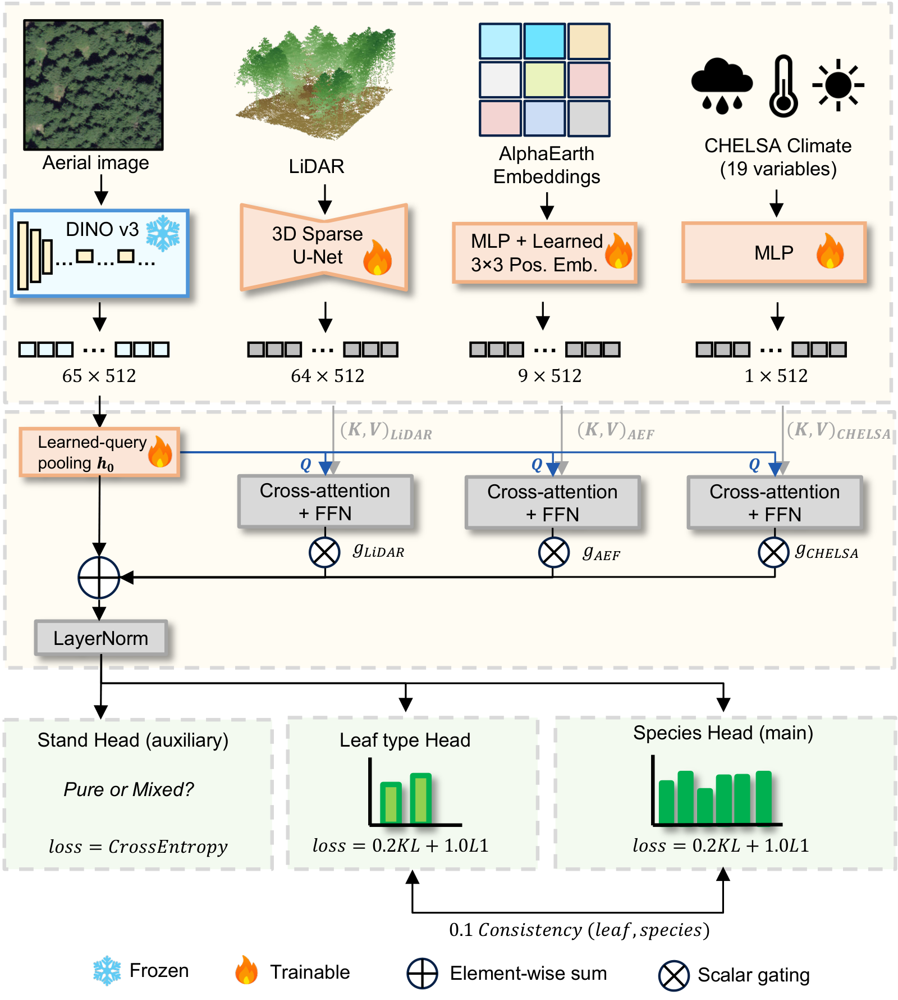
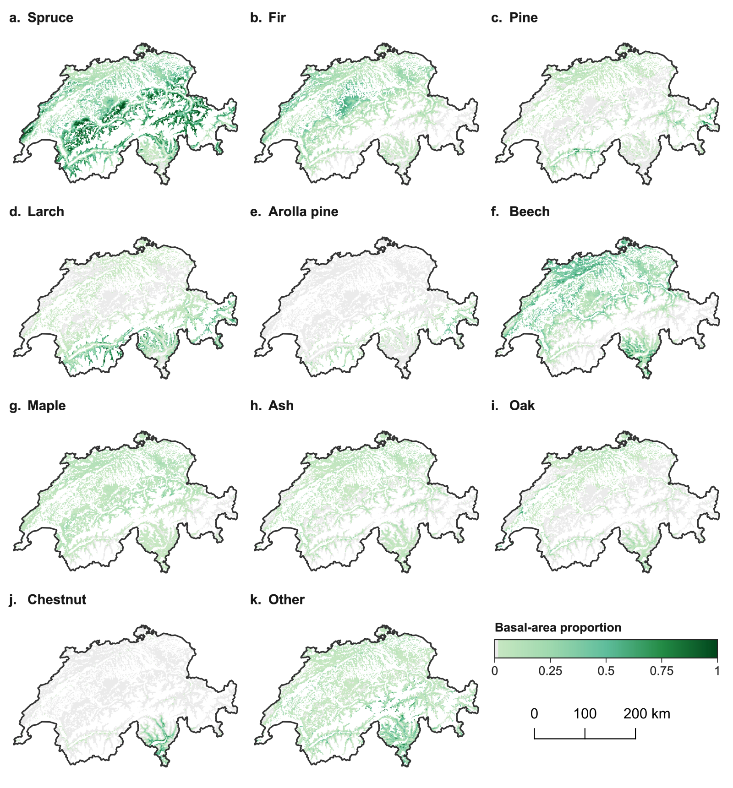

# 🌲 National-scale Tree Species Mapping in Switzerland Using Multimodal Remote Sensing Data

A multimodal framework for mapping the basal-area shares of **ten tree species and Other** across Switzerland. The model combines aerial RGB imagery, LiDAR, AlphaEarth embeddings, and CHELSA climate data, with auxiliary predictions of leaf type and stand type.

<p align="center">
  
</p>

## 📊 Results

Results reported in the manuscript, as mean ± SD over five spatial CV folds (3,992 NFI sites).

| Model | Species MAE ↓ | Species R² ↑ | Dominant-class macro-F1 ↑ |
| --- | --- | --- | --- |
| **Multimodal ViT-H+/16** | **0.048 ± 0.001** | **0.485 ± 0.038** | **0.585 ± 0.014** |
| ResNet-50 | 0.058 ± 0.002 | 0.380 ± 0.043 | 0.515 ± 0.027 |
| Random forest | 0.083 ± 0.001 | 0.313 ± 0.012 | 0.342 ± 0.031 |
| AlphaEarth MLP | 0.084 ± 0.002 | 0.157 ± 0.014 | 0.194 ± 0.012 |

<p align="center">
  
</p>

*National composition maps: 30 m predictions aggregated to 990 m cells for display.*

## ⚙️ Environment Setup

Use **Python 3.11** and a CUDA-enabled GPU. Package versions in [requirement.txt](requirement.txt) are exported from the current training environment (PyTorch 2.11.0, CUDA 13.0).

```bash
pip install -r requirement.txt
```

Download the **DINOv3 ViT-H+/16 LVD-1689M** backbone from the [official project](https://github.com/facebookresearch/dinov3#pretrained-models). Rename the downloaded checkpoint and place it at:

```text
checkpoints/dinov3_vith16plus.pth
```

See [checkpoints/DOWNLOAD.txt](checkpoints/DOWNLOAD.txt) for instructions. This path is already set in [configs/main.yaml](configs/main.yaml).

## 🚀 Training

**The original training data cannot be made publicly available under the applicable data-sharing agreement.** To request access to Swiss National Forest Inventory (NFI) data, please contact the responsible department at the Swiss Federal Institute for Forest, Snow and Landscape Research WSL. Reproducing the paper requires authorized NFI-derived HDF5 files and the original private five-fold index. Sample IDs, coordinates, labels, fold assignments, and per-sample results are not distributed.

Set `path.hdf5` in `configs/main.yaml` to the directory containing the HDF5 files and `index.csv`. Run from the repository root:

```bash
python scripts/train.py --gpus 0
```

For two GPUs:

```bash
python scripts/train.py --gpus 0,1
```

The script trains all five folds for **80 epochs each**, prints the effective configuration, and saves each fold's final EMA weights.

## 🧪 Evaluation

```bash
python scripts/evaluate.py --gpus 0
```

Each model is evaluated on its held-out fold. The paper's main summary is **fold_metrics_mean_std.csv**, containing the mean and standard deviation of the five fold-level metrics. Results are saved below `outputs/experiments/reference_model/cross_validation/`.

To use another training directory, add `--experiment-root /path/to/cv_run`. Evaluation also requires access to the authorized data. Keep locally generated per-sample outputs private.

---

Built on [DINOv3](https://github.com/facebookresearch/dinov3) and [spconv](https://github.com/traveller59/spconv). Source attribution and licenses are retained alongside the relevant implementations.

## 🔗 Links

- [National tree-species composition maps on Zenodo](https://doi.org/10.5281/zenodo.23263490)
- [Interactive visualization on TreeAI](https://www.treeai.earth/swiss-species-composition)
